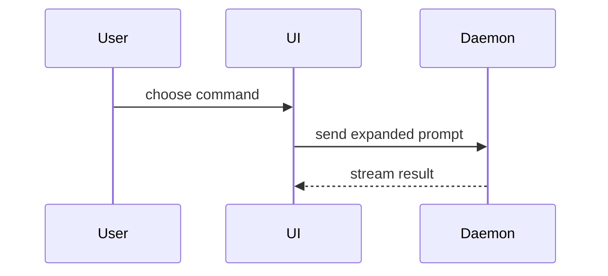

Use the project's PR template when it has one. Otherwise use this template for writing the PR body, with its headings in the project's language:

```markdown
## Decision needed

<the decision or check the owner must make>

## What changed

<one to three sentences, with a diagram, diff-sketch, or tree when it helps>

## Verified

- <scenario: what was done and what was seen> 

Not verified: <what was left unchecked and why>

## Merge Danger

**Door:** <one-way or two-way>. **Blast Radius:** <one-word description>

<details>
<summary>How it works</summary>

<a diagram of the calls, then the key places in the code>

</details>

<details>
<summary>Details</summary>

<for agents: base and head, check runs with links, review reports>

</details>

Closes #<issue>
```

The title names the change in the user's words and nothing else: no author, agent, client, model or ticket label.

## Sections

The owner reads everything outside **Details** and nothing inside it. Keep the owner's text under 70 words, headings aside: it should read in a minute. Omit a section that has nothing to say. Keep commit hashes and check logs inside Details.

Name no person in a heading or in the body: write "Decision needed", not "<name>'s decision", and address the reader as "you". Name no agent, client or model either, and add no authorship prefix. Skip all preambles and keep prose brief. Use the user's domain language from `GLOSSARY.md`.

### Decision needed

Start with the owner-gate status and reason when one was given. Then one concrete question or action per line, with what the answer decides. Omit the section when the owner has nothing to do.

### What changed

Say what is different for the user. Pick the smallest view that makes the key point clear.

- Show logic or an algorithm as pseudocode:

```text
on(save)
  if content is unchanged
    return cached result
  write new content
  return fresh result
```

- Show runtime control flow as a call tree:

```text
submitForm
  createSession
    persistPrompt
    launchAgent
  navigateToSession
```

- Show UI structure as a component tree, including state and module boundaries that matter:

```text
<SessionPage> (apps/example/src/routes/session.tsx)
  useSessionEvents()
  <SessionToolbar>
    <RunSkillButton> (packages/ui)
```

- Show file responsibility or a broad refactor as a shallow file tree:

```text
src/
├── commands/       # parses user actions
├── sessions/       # owns session state
└── transport/      # sends API requests
```

- Show component interaction, control flow, or data flow with Mermaid:



- Use `diff` when the point is what changes and the surrounding shape already exists. Match the diff shape to the topic.

For a component change:

```diff
 <SessionPage>
   useSessionEvents()
   <SessionToolbar>
+    <RunSkillButton />
   <SessionTimeline>
+    <SkillResultCard />
```

For a file-layout change:

```diff
 src/
 ├── commands/
+│   └── show-me.ts       # expands the slash command
 ├── sessions/
-└── transport.ts
+└── transport/
+    ├── client.ts
+    └── stream.ts
```

For a call-tree or call-stack change:

```diff
 submitForm
   createSession
     persistPrompt
+    expandSkillMention
     launchAgent
-  navigateToSession
+  navigateToSession
+    subscribeToEvents
```

For a state or control-flow change:

```diff
 on(save)
-  write content
+  if content is unchanged
+    return cached result
+  write new content
+  invalidate cache
```

- Show the whole block when most of it is new, when omitted context would hide ownership or order, or when the user needs a copyable target shape:

```ts
function expandSkill(command: string): string {
  const skillName = command.slice(1);
  return `use the ${skillName} skill`;
}
```

#### Guidance

Place each visual next to the short text it supports. Keep only the calls, files, props, states, and boundaries needed to answer the user's current question or the options to resolve the current discussion point.

You may use one of these, you may use several, it is unlikely you will use all of them. Use your judgement and don't overwhelm the user.

### Verified

One line and one piece of evidence per scenario. Take both from the verification report: a verifier in another session leaves `report.md` in the folder the project settings name. Without a report, show a before and after.

Screenshots are S-tier - when the environment is set up for it and the change is visual.

Execution-based evidence is A-tier. Test results, console output. Show the exact test that now fails and passes, using pseudocode.

Store evidence files the way the project says. On GitHub with no project rule, attach them with `gh pr create --attach` or `gh pr edit --attach` and reference each as ``. An attachment is public and permanent: attach test data only, and when in doubt describe the result in words.

The host rewrites a relative reference only in the command that uploads the file. When you rewrite a body later, keep the uploaded URLs it already has. After every write, read the body back from the host: an image whose link is not an absolute URL is broken for the owner.

### Merge Danger

Describe whether it's a one-way or two-way door. You can walk back through two-way doors, but not one-way doors. A PR that is cheap to roll back is lower risk. Changes that involve destructive actions or hard-to-reverse decisions are one-way doors.

The blast radius is the potential impact or scope of the changes introduced by this PR. Consider all possibilities. Examples are layout shift, breakages for consumers, mobile responsiveness, etc.

### How it works

Include it when the change adds or alters behaviour; omit it for a change of settings, text or dependencies. It stays collapsed, below Merge Danger, for an owner who wants the mechanism.

Start with a Mermaid diagram of one request or action from the entry point to the stored result: what calls what, where the decision is made, what is saved. Under it list the three to six places in the code that carry the behaviour, each a link to the line at the PR head with one sentence on what it does. Name no helper that only passes data on.

### Details

Written for agents, not the owner: the base and head, each check with a link to its run, the review reports. Never retell the diff.
