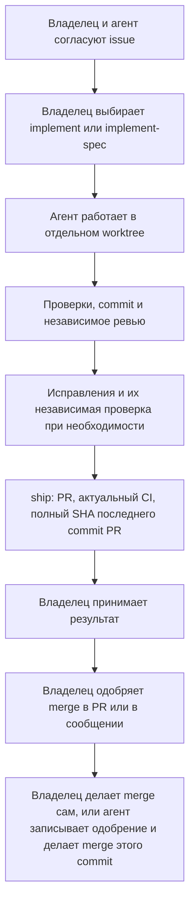

# Работа с harness

Карта объясняет правила агента и не добавляет полномочий.
Issue — задача в трекере. Spec — согласованное изменение со сценариями и критериями приёмки.
Worktree — отдельная рабочая копия со своей веткой. CI — автоматические проверки репозитория.

## Выбор маршрута

| Ситуация | Подготовка | Реализация |
| --- | --- | --- |
| Понятная небольшая задача | Короткая issue: результат, границы, критерии и проверки | Владелец выбирает `implement` |
| Идея с открытыми решениями | Обсуждение; исследование или прототип по необходимости | После согласования ограниченного изменения |
| Большое изменение | `to-spec`; `to-tickets`, когда нужны зависимости частей | По умолчанию каждый ticket через `implement`; `implement-spec` — по причине из spec |
| Непонятный баг | `diagnosing-bugs` собирает воспроизведение и причину | Диагностика сама по себе не разрешает исправление |
| Быстрый фикс | Короткая issue; полная spec обычно не нужна | Действуют те же правила worktree и проверок |

Достаточно назвать skill обычной фразой: «Выполни issue 12 через implement».
Просьба без названия приводит к предложению маршрута, а не автоматическому запуску.

## Где описано поведение

Spec отвечает на вопрос «что тогда попросили и почему». После merge её никто не переписывает.
В проекте с этим harness текущее поведение показывают тесты проекта.
Отдельного документа с текущим поведением такой проект не ведёт.
`DOMAIN.md` хранит термины. ADR хранят существенные решения.
Новая issue ссылается на прежнюю и называет каждый заменённый критерий.
[Правила требований](agents/requirements.md#current-behavior-and-history) называют источник для каждого вопроса.
У этого репозитория нет тестов приложения.
Его границы описывает `docs/requirements.ru.md`.

## Ревью и исправления

`code-review` запускает независимых Standards и Spec reviewers. Они возвращают отчёты и не меняют файлы.
В `implement` исправления делает основная сессия.
В `implement-spec` один свежий implementer исправляет общий результат.
Затем затронутые проверки и независимое ревью покрывают исправления и связанные взаимодействия.
Предыдущее полное ревью остаётся частью доказательств.
Необязательные улучшения не создают обязательный новый цикл и не расширяют поручение.
Спорные решения и циклы без прогресса возвращаются владельцу.
Численного предела и отдельного механизма арбитража сейчас нет.

## Большая spec

Spec выбирает один из двух режимов доставки в разделе «Приёмка».
[Правила доставки](agents/delivery.md#delivery-modes) описывают оба режима.

| Режим | Когда | Как идёт работа |
| --- | --- | --- |
| PR на каждый ticket | По умолчанию | Каждый ticket проходит через `implement` и получает свой PR. Следующий ticket начинается от `main` после приёмки и merge предыдущего PR. |
| Один интеграционный PR | Tickets нельзя показать или держать зелёными по отдельности | `implement-spec` собирает tickets в integration branch. Spec называет причину выбора. |

В интеграционном режиме основная сессия читает tickets как граф зависимостей.
Готовые независимые tickets выполняют отдельные workers в своих worktrees.
Сборка в integration branch проходит последовательно.
Workers используют `tdd`; `code-review` проверяет общий интегрированный результат.
Spec получает draft PR после первого интегрированного результата и использует его дальше.
Этот PR закрывает spec и все её tickets.

## Участие человека

Правила приёмки имеют два уровня.
[Правила участия человека](agents/human-review.md#acceptance-levels) описывают оба уровня.

Уровень 1 действует для любой работы. Владелец принимает каждый PR по его отчёту.
Отчёт PR всегда содержит пять частей:

1. Что теперь работает с точки зрения пользователя.
2. Как проверить самому: шаги и ожидаемый результат.
3. Доказательства.
4. Что не сделано или ограничено.
5. Что должен решить владелец.

Уровень 2 действует для каждой spec. Её раздел «Приёмка» называет режим доставки.
Он также перечисляет дополнительные человеческие проверки и то, что показывает каждый ticket.
Tickets наследуют проверки spec и добавляют свои в критерии приёмки.

При подготовке issue или spec согласуйте дополнительные человеческие проверки.
Выбирайте их по последствиям и пробелам доказательств, а не только по размеру diff.
Права, необратимые действия, бизнес-правила, значимый UX, архитектура, CI и полномочия агента могут требовать отдельной проверки.
Перед передачей независимый Spec reviewer проверяет, не пропущен ли вопрос человеку.

Для проверки объясните изменение, возможную ошибку, последствие, роль, действие и ожидаемый результат.
Покажите, что уже подтверждают автоматические проверки и какая неопределённость остаётся.
Укажите срок решения и зависимую работу, которая ждёт ответа.
Каждый PR принимает владелец, даже если дополнительный ручной тест не нужен.

## Доставка

`ship` отправляет проверенную ветку и использует `pr` для описания.
Он создаёт или обновляет draft, ждёт текущий CI и передаёт результат владельцу.
Малая задача или ticket создаёт draft после проверок и ревью. Интеграционная spec использует прежний draft.
Исправления CI остаются в границах поручения и получают затронутые проверки и ревью.
Приёмка и разрешение merge разделены.
Владелец может одобрить merge в PR или в сообщении. Агент записывает источник и полный SHA.
Разрешённый агенту merge проверяет этот SHA. Любой новый commit требует нового разрешения.
Worktrees разделяют файлы, но не credentials или общие сервисы.

## Развитие примера

Начните с обычных задач и фиксируйте затруднения перед добавлением правил.
Закреплённый Matt `implement-spec` требует свежего исправителя, но не предписывает повторное ревью.
Проверка исправлений и доставка проверенного PR — наши решения.
